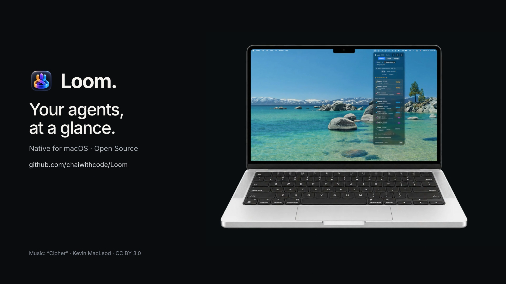
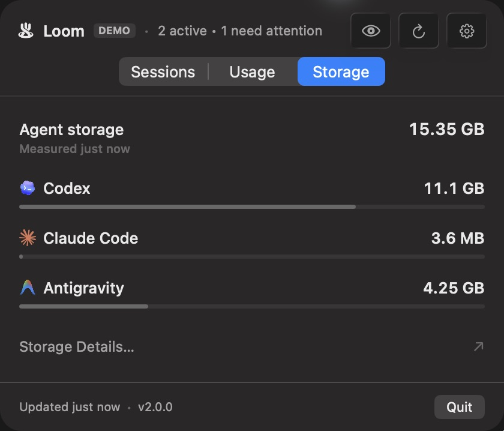
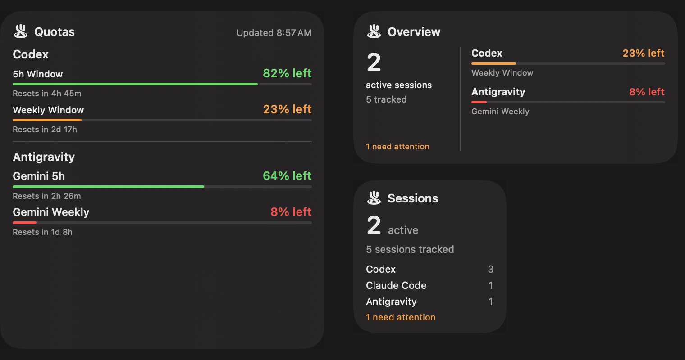

<p align="center"></p>
<h1 align="center">Loom</h1>
<p align="center"><strong>Three agents. One Loom.</strong><br>Monitor Codex, Claude Code, and Antigravity from one native macOS menu-bar app.<br><br>
<strong><a href="https://chaiwithcode.github.io/Loom/">Website</a> &nbsp;·&nbsp; <a href="docs/loom-2.0-trailer.mp4">Watch Demo</a> &nbsp;·&nbsp; <a href="https://github.com/chaiwithcode/Loom/releases/latest">Download</a></strong></p>

<p align="center">
  <a href="docs/loom-2.0-trailer.mp4"></a>
  <br><sub>Loom 2.0 · Demo data is illustrative. <a href="docs/loom-2.0-trailer.mp4">Watch the 2.0 trailer</a>.</sub>
</p>

<p align="center">
  <a href="https://chaiwithcode.github.io/Loom/"><strong>Official Website</strong></a> &nbsp;•&nbsp;
  <a href="https://github.com/chaiwithcode/Loom/releases/latest"><strong>Download for macOS (DMG)</strong></a> &nbsp;•&nbsp;
  <a href="#homebrew-recommended"><strong>Install with Homebrew</strong></a> &nbsp;•&nbsp;
  <a href="https://github.com/chaiwithcode/Loom/releases"><strong>GitHub Releases</strong></a>
</p>

---

## Why Loom?

When you run multiple local AI coding agents across background terminals, editor extensions, and language servers, answering a simple question becomes surprisingly tedious: *"What are all my local AI coding agents doing on my Mac right now?"*

Loom gives you one clean, local-first menu-bar application to see which project each agent is working on and which session needs attention—without switching between terminals, browser dashboards, and apps. For quota-capable providers, Loom shows observed remaining quota and can warn at 15% and 5%; Claude Code quota is unsupported by its upstream local interface, so Loom does not invent a value.

**Loom 2.0 — Liquid Glass & Smarter Monitoring** brings clearer session states, local quota warnings, and native desktop widgets. See the [2.0 release notes](docs/RELEASE_NOTES_v2.0.0.md); downloads always open the latest published release.

Built with Swift and SwiftUI for macOS 14+. Featuring a native **Liquid Glass popover redesign**, **actionable desktop notifications**, **session productivity quick actions**, and **instant search & filtering**. Strictly local-first: no Loom account, no hosted backend, no analytics SDKs, and no third-party dependencies except official Sparkle 2 for signed, secure local updates.

---

## Local Agent Sessions & Productivity

The **Sessions** tab answers *"what is happening right now?"* with attention-first prioritization and rich productivity tools:

<p align="center">
  
</p>

- **Liquid Glass Redesign**: Native macOS 26+ popover styling adopting Apple's Liquid Glass (`.glassEffect`) with high-craft material fallbacks (`.ultraThinMaterial`) on macOS 14/15.
- **Attention-First Prioritization**: Sessions requiring human input (`waiting`) or encountering errors (`failed`) are surfaced prominently at the top with high-contrast amber/red badges, ensuring pending decisions are never missed.
- **Collapsible Recent Sessions**: Completed tasks tuck cleanly into a collapsible disclosure section, keeping active work front and center.
- **Search & Filter Bar**: Filter sessions instantly using search queries (repository name, Git branch, or host app) or quick category chips (`All`, `Needs Attention`, `Working`, `Recent`).
- **Productivity Quick Actions**:
  - **Focus Terminal / IDE**: Brings the active host editor or terminal window (VS Code, Cursor, Terminal, iTerm2) directly to the front.
  - **Copy PID**: Copies the root worker process identifier to the pasteboard.
  - **Copy Repository Path**: Copies the project path (sanitized when privacy mode is active).
  - **Copy Session ID**: Copies the upstream provider session token for correlation with external logs.
  - **Reveal in Finder**: Direct disk navigation via macOS Finder.
- **Strict Read-Only Safety**: Loom provides zero destructive controls (`kill`, `SIGTERM`, or prompt injection).

---

## Native macOS Notifications

Stay informed on background agent execution and quota exhaustion without polling or keeping the popover open:

- **Quota Threshold Alerts**: Early warnings below **15%** and critical alerts below **5%** for observed Codex and Antigravity quota windows (5-hour and weekly, respectively). Claude Code quota is not exposed by its upstream local interface and is not included.
- **Verified Replenishment Alerts**: Desktop notification when a fresh observation confirms quota has recovered to ~100% in a newly started window (never inferred purely from countdown timers).
- **Session Lifecycle Transitions**: Actionable alerts when an agent transitions into **Waiting for Input**, **Finished**, or **Failed**.
- **Hygiene & Persistent Deduplication**: Cross-restart deduplication keys prevent repeated alert spam across polling cycles. Silently seeds baseline state on launch to prevent notification storms.
- **Privacy & Deep Linking**: File system paths in alerts are automatically masked when **Hide project paths** is active. Clicking a notification routes directly to the relevant provider and session in Loom.

---

## Usage, Quotas & Local Storage

Keep track of rate limits, pacing velocity, and on-disk footprint in one place:

<p align="center">
  
  &nbsp;&nbsp;&nbsp;&nbsp;
  
</p>

- **Truthful Quotas & Pacing (Usage)**: View remaining quota percentages, consumption velocity, and exact reset dates/times. Missing or unsupported telemetry is never masked as healthy: Claude Code is truthfully marked as *Quota not supported* by upstream local interfaces, while Codex and Antigravity report verified live metrics.
- **Local Disk Footprint (Storage)**: Measure on-disk agent caches, conversation transcripts, language server indices, and log files on demand across all providers with bounded, read-only scans. Displays clean comparative proportions and direct Finder navigation.

---

## Native macOS Widgets

Glance at agent sessions and quotas directly on your desktop or Notification Center with three native widgets:

<p align="center">
  
  <br><sub>Native widget previews with privacy-safe demo data.</sub>
</p>

- **Loom Quotas** (Small, Medium, Large): Displays prominent remaining percentages and reset countdowns. Configurable via *Edit Widget* to monitor all enabled providers together or focus on a specific provider.
- **Loom Sessions** (Small, Medium): Real-time view of active sessions, waiting-for-input alerts, and per-provider counters.
- **Loom Usage Overview** (Medium, Large): Multi-column comparison (Medium) or detailed vertical breakdowns with granular model limits (Large).

See [widget setup and verification guide](docs/WIDGETS.md) and [interface and storage details](docs/INTERFACE_AND_STORAGE.md).

---

## Supported Providers

| Provider | Session Discovery | Quota / Usage | Local Storage | Status |
| :--- | :--- | :--- | :--- | :--- |
| **OpenAI Codex** | Running processes, process tree, and Git metadata | Local app-server interface (`stdio`) | Caches, sessions & logs | Production |
| **Google Antigravity** | Local session metadata and language-server processes | Local loopback HTTPS interface with ephemeral token | Store, artifacts & logs | Production |
| **Anthropic Claude Code** | Running processes, process tree, CLI detection, transcripts | Not exposed by upstream CLI | State, config & transcripts | Production |

Normal launch registers **Codex, Claude Code, and Antigravity**. Process trees correlate child workers and helpers into exactly one logical session per repository task. Expandable discovery diagnostics report processes detected, logical sessions, workspace resolution ratio, metadata health, and discovery latency in milliseconds.

*Loom is an independent open-source project and is not affiliated with or endorsed by OpenAI, Anthropic, or Google.*

---

## Installation

### Homebrew (Recommended)

Install Loom via the official [ChaiWithCode Homebrew Tap](https://github.com/chaiwithcode/homebrew-tap):

```bash
brew install --cask chaiwithcode/tap/chaiwithcode-loom
```

### Direct Download

1. Download **`Loom-1.0.dmg`** from [GitHub Releases](https://github.com/chaiwithcode/Loom/releases).
2. Open the disk image.
3. Drag **Loom.app** into your `/Applications` folder.
4. Launch **Loom** from Applications or Spotlight.

### Software Updates

Loom integrates native software updates powered by **Sparkle 2**. Updates are delivered over HTTPS from the official [GitHub Pages appcast feed](https://chaiwithcode.github.io/Loom/appcast.xml), cryptographically signed with EdDSA (Ed25519), and notarized by Apple.

You can check for updates anytime:
- Via **Check for Updates…** in the Loom menu or Dock menu
- In **Settings** (`⌘,`) under the **General** tab

---

## Privacy & Local-First

Loom is built from the ground up for developer privacy and security:

- **No Loom Account**: There are no accounts, cloud logins, or external servers.
- **Local Process Inspection**: Loom inspects local processes and metadata on your Mac. It is strictly read-only: it does not inject prompts, approve commands, edit projects, or modify agent sessions.
- **Zero Telemetry**: No tracking, analytics, or behavioral telemetry SDKs.
- **Ephemeral Credentials**: Codex usage communicates via local stdio. Antigravity usage communicates with a discovered local loopback endpoint using an ephemeral memory token. Tokens are never persisted to disk.
- **Path Concealment & Quick Action**: Enable the **Hide project paths** privacy toggle in Settings (`⌘,`) or directly via the popover header quick-toggle to mask filesystem paths across the UI, tooltips, and notification banners.

See [security guidance](SECURITY.md) and [architecture](docs/ARCHITECTURE.md).

---

## Settings and Configuration

Press `⌘,` or click the header gear icon to open Loom Settings:

- **General**: Choose your Menu Bar Status Mode (`Icon Only`, `Active Sessions count`, `Lowest Quota percentage`), toggle Dock visibility, and configure background refresh intervals.
- **Providers**: Enable or disable monitoring individually for Codex, Claude Code, and Antigravity. Disabling a provider immediately halts process discovery and polling tasks.
- **Notifications**: Configure system alert triggers (15% and 5% quota warnings, reset alerts, session state transitions), send test notifications, and inspect the bounded local notification audit log.
- **Sessions & Retention**: Filter to active sessions only or retain completed sessions for a configurable period (Never, 1 hour, 24 hours, 7 days).
- **Storage**: Run on-demand storage scans and inspect per-folder breakdowns with direct Finder navigation.
- **Privacy**: Manage filesystem path masking across all views and alerts.

---

## Build and Run

Requires **macOS 14+** and **Swift 5.9+ / Xcode 15+**. Install the coding tools you want to monitor separately. From the repository root:

```bash
bash scripts/build-app.sh
open .build/Loom.app
```

This builds a Release executable and packages a local development app with the Loom icon. It is an ad-hoc signed build for local development, not a Developer ID-signed or notarized distribution download. See [Release Documentation](docs/RELEASING.md) for public distribution prerequisites, Developer ID signing, and Apple notarization.

For Xcode, open `Loom.xcodeproj`, select the **Loom** scheme and **My Mac**, then press **⌘R**. Launch the bundled app when checking icon identity and native UI behavior.

### Preview without live agents

Build the bundle first using the command above. Demo data is explicitly opt-in and visibly labeled:

```bash
open -n .build/Loom.app --args --demo-mock
open -n .build/Loom.app --args --demo-mock --show-settings
open -n .build/Loom.app --args --demo-empty
open -n .build/Loom.app --args --demo-failure
```

The mock fixture includes all three provider identities and normalized states for testing and visual previews. To preview notification banners, add one of the six demo scenarios below; the alert appears after three seconds. Demo alerts require the mock fixture and notification permission, and never run during a normal launch:

```bash
open -n .build/Loom.app --args --demo-mock --demo-alert codex-warning
open -n .build/Loom.app --args --demo-mock --demo-alert codex-critical
open -n .build/Loom.app --args --demo-mock --demo-alert codex-reset
open -n .build/Loom.app --args --demo-mock --demo-alert antigravity-warning
open -n .build/Loom.app --args --demo-mock --demo-alert antigravity-critical
open -n .build/Loom.app --args --demo-mock --demo-alert antigravity-reset
```

See [demo media details and attribution](docs/DEMO_MEDIA.md).

---

## Development and Verification

```bash
swift build

# Portable suite: unit, integration, and cancellation regression tests.
swift test

# Native menu sizing and interaction probe.
bash scripts/verify-menu-sizing.sh
```

The macOS [CI workflow](.github/workflows/ci.yml) builds/packages the app and runs the portable suite. The native probe checks content sizing, tab/disclosure behavior and constrained layouts; it does not replace checking the actual menu bar on a Mac.

`swift test` runs the full test suite across Codex, Claude Code, Antigravity, settings, and UI components. In local verification, the full suite passes, including SIGTERM-resistant cancellation regression checks. CI executes the portable suite while excluding only the live Antigravity discovery smoke test (`testRealAntigravityDiscoverySmokeTest`), which requires a local Antigravity database installation. SQLite WAL lock contention and code 14 (`SQLITE_CANTOPEN`) are handled gracefully via `?immutable=1&mode=ro` and temporary snapshot fallbacks. Some live usage checks additionally require `ENABLE_LIVE_SMOKE_TESTS=1`.

### Dedicated Regression Tests (`LoomRegressionTests`)

A dedicated test target, `LoomRegressionTests`, isolates core regression tests across process trees, session disambiguation, lifecycle transitions, widget state consistency, and headless SwiftUI smoke rendering:

```bash
# Run regression tests via SwiftPM
swift test --filter 'LoomRegressionTests.*'

# Run regression tests via Xcode CLI
xcodebuild test -project Loom.xcodeproj -scheme LoomRegressionTests -destination 'platform=macOS'
```

- **In Xcode**: Select the **LoomRegressionTests** scheme and press **⌘U**, or open the **Test Navigator (⌘6)** and run `LoomRegressionTests` directly. The primary **Loom** scheme's Test action also includes `LoomRegressionTests`.
- **Adding new regression tests**: Place new tests in `Tests/LoomRegressionTests/` (such as in `LoomRegressionTestSuite.swift`), preserving the canonical MIT license header (`AGENTS.md`) and importing `@testable import LoomCore`.

Xcode builds are also supported:

```bash
xcodebuild build -project Loom.xcodeproj -scheme Loom -destination 'platform=macOS'
```

See [CONTRIBUTING](CONTRIBUTING.md) for fixtures, review expectations and provider work.

See [widget verification and troubleshooting](docs/WIDGETS.md) for local widget builds, installation, shared storage, and Notification Center checks.

---

## What Comes Next

Reliable local discovery comes first: improve state accuracy, cover upstream format changes, and expand diagnostics and accessibility. Remote control, cloud sync and orchestration are outside the current scope.

The visual identity stays simple: three independent strands woven into one Loom. The full-color app icon and simplified monochrome menu bar glyph share that silhouette. See [icon design notes](docs/ICON_DESIGN.md) and [product direction](docs/PRODUCT.md).

---

## License and Author

Created by **[Deepak Sharma](https://github.com/chaiwithcode)**.

Loom's code, documentation and included assets are licensed under the [MIT License](LICENSE). You can use, modify and distribute them under its terms. [Branding guidance](BRANDING.md) explains how to distinguish your fork from the official project without changing that license.
