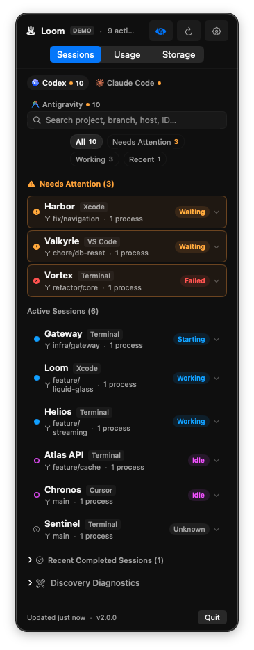
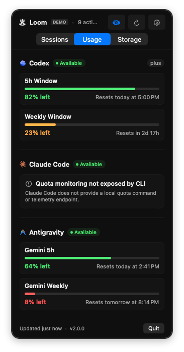
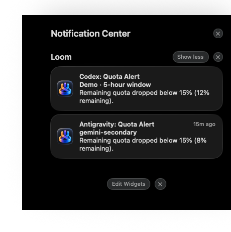
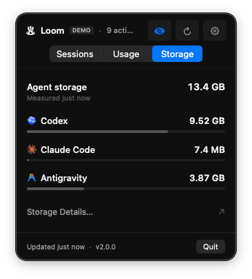

<p align="center"></p>
<h1 align="center">Loom</h1>
<p align="center"><strong>Your agents, at a glance.</strong><br>See what Codex, Claude Code, and Antigravity are doing on your Mac in one native menu bar app.<br><br>
<strong><a href="https://github.com/chaiwithcode/Loom/releases/latest">Download Loom</a> &nbsp;·&nbsp; <a href="#installation">Installation</a> &nbsp;·&nbsp; <a href="https://chaiwithcode.github.io/Loom/">Website</a> &nbsp;·&nbsp; <a href="https://github.com/chaiwithcode/Loom">GitHub</a></strong></p>

<p align="center">
  <a href="https://github.com/chaiwithcode/Loom/releases/download/v2.0.0/Loom-Demo-16x9.mp4"></a>
  <br><sub><a href="https://github.com/chaiwithcode/Loom/releases/download/v2.0.0/Loom-Demo-16x9.mp4">Watch the Loom 2.0 trailer</a> · Session and quota examples are illustrative demo data.</sub>
</p>

Loom is a local-first macOS app for keeping track of local AI coding agent sessions. Check which sessions are working, waiting, idle, or need attention, and open diagnostics when discovery needs a closer look. Loom observes local processes and provider data; it does not control agents or edit your projects.

**Loom 2.0.0** supports Apple Silicon (`arm64`) and macOS 14 or later. See the [2.0 release notes](docs/RELEASE_NOTES_v2.0.0.md) for details.

## Installation

### Homebrew

```bash
brew install --cask chaiwithcode/tap/chaiwithcode-loom
```

### Download

Download the latest **Loom** disk image from [GitHub Releases](https://github.com/chaiwithcode/Loom/releases/latest), open it, and drag **Loom.app** into Applications.

Loom includes signed updates through Sparkle. Check for updates from the Loom menu or in **Settings → General**.

## Sessions

The Sessions view brings agent activity into one place. Waiting and failed sessions are surfaced first, followed by working and idle sessions; recent sessions can be collapsed.

<p align="center"><a href="docs/loom-2.0-desktop-sessions.png"></a></p>

Search by repository, branch, or host app, then filter by attention, working, or recent activity. Available actions include focusing the host app, copying process or session details, and revealing a workspace in Finder.

Loom supports session discovery for **OpenAI Codex**, **Google Antigravity**, and **Anthropic Claude Code**. Discovery and workspace details depend on the evidence each provider exposes locally; Loom reports diagnostics rather than guaranteeing a session for every repository or process.

*Loom is an independent open-source project and is not affiliated with or endorsed by OpenAI, Anthropic, or Google.*

## Quotas and notifications

For Codex and Antigravity, Loom can show quota data available through their local interfaces and send threshold or reset notifications. Quota alerts support **15%** and **5%** thresholds. Claude Code does not expose quota through its upstream local interface. Quota readings are observations and may be unavailable when a provider cannot be reached.

<p align="center"><a href="docs/loom-2.0-desktop-usage.png"></a></p>

Notifications can cover observed quota thresholds and session state changes. Finished alerts can be set to require a minimum observed working duration; Loom measures that duration while it is monitoring. Notification preferences and macOS permission choices are respected. Test-notification controls are available only in Debug builds.

<p align="center"><br><sub>Notification examples use illustrative data.</sub></p>

## Local storage

Inspect local agent data with on-demand, read-only storage scans and per-folder breakdowns.

<p align="center"><a href="docs/loom-2.0-desktop-storage.png"></a></p>

## Widgets

Loom includes Sessions, Quotas, and Overview widgets for the desktop and Notification Center.

<p align="center">
  
  <br><sub>Widget previews use illustrative, privacy-safe demo data.</sub>
</p>

The Sessions, Usage and Storage images are the original individual-window captures from the 2.0 video; click them to see the original desktop captures with native Liquid Glass. Widget previews and notification captures also show the current 2.0 interface; session, quota, and storage values shown are illustrative demo data.

See [widget setup and verification](docs/WIDGETS.md) and [interface and storage details](docs/INTERFACE_AND_STORAGE.md).

## Privacy and local operation

Loom has no account or hosted backend. It reads local process and provider information to discover sessions and quota data. It is read-only with respect to agent sessions and project files: it does not send prompts, approve commands, or modify projects.

Enable **Hide project paths** in Settings to mask paths in the interface and notification content. Antigravity quota access uses a local loopback connection and an ephemeral in-memory token. See [security guidance](SECURITY.md) and the [architecture overview](docs/ARCHITECTURE.md).

## Settings

Open Settings with **⌘,** or the gear button. Configure providers, menu bar status, refresh behavior, notification preferences, session retention, path privacy, and local storage scans. Provider-specific availability and notification behavior are described in the [2.0 release notes](docs/RELEASE_NOTES_v2.0.0.md).

## Build and development

Loom requires **macOS 14+** and **Swift 5.9+ / Xcode 15+**. Install the coding tools you want to monitor separately. From the repository root, build and open the local app bundle:

```bash
bash scripts/build-app.sh
open .build/Loom.app
```

This creates an ad-hoc signed development app, not a Developer ID-signed or notarized distribution download. See [release documentation](docs/RELEASING.md) for distribution. In Xcode, open `Loom.xcodeproj`, select the **Loom** scheme and **My Mac**, then press **⌘R**.

<details>
<summary>Preview with opt-in demo data</summary>

After building, launch one demo mode at a time. These options do not run during a normal launch:

```bash
open -n .build/Loom.app --args --demo-mock
open -n .build/Loom.app --args --demo-mock --show-settings
open -n .build/Loom.app --args --demo-empty
open -n .build/Loom.app --args --demo-failure
```

To preview illustrative quota notification scenarios, use one command at a time; each alert appears after three seconds and requires macOS notification authorization:

```bash
open -n .build/Loom.app --args --demo-mock --demo-alert codex-warning
open -n .build/Loom.app --args --demo-mock --demo-alert codex-critical
open -n .build/Loom.app --args --demo-mock --demo-alert codex-reset
open -n .build/Loom.app --args --demo-mock --demo-alert antigravity-warning
open -n .build/Loom.app --args --demo-mock --demo-alert antigravity-critical
open -n .build/Loom.app --args --demo-mock --demo-alert antigravity-reset
```

</details>

For development checks, run `swift test` for the portable suite, or `swift test --filter 'LoomRegressionTests.*'` for regression tests. See [CONTRIBUTING](CONTRIBUTING.md), [widget verification](docs/WIDGETS.md), and [demo media notes](docs/DEMO_MEDIA.md) for more details.

## Project direction

Loom prioritizes reliable local agent discovery, session correlation, workspace resolution, truthful lifecycle state, diagnostics, and graceful degradation. Remote control, cloud sync, and orchestration are outside the current scope. Read more in [product direction](docs/PRODUCT.md).

## License and author

Created by [Deepak Sharma](https://github.com/chaiwithcode). Loom's source code and documentation are licensed under the [MIT License](LICENSE). Promotional media includes third-party material; see [media attribution and licenses](docs/DEMO_MEDIA.md). See [branding guidance](BRANDING.md) for information about naming and presenting forks.
