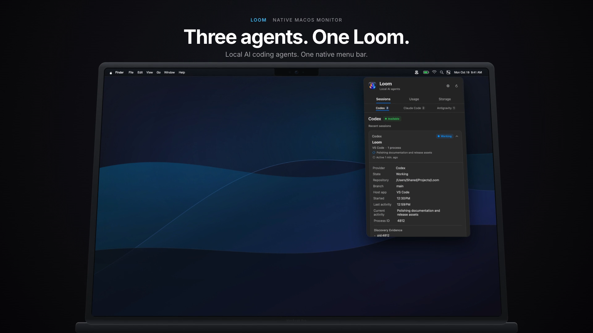

<p align="center"></p>
<h1 align="center">Loom</h1>
<p align="center"><strong>Three agents. One Loom.</strong><br>Monitor Codex, Claude Code, and Antigravity from one native macOS menu-bar app.</p>

<p align="center">
  <a href="https://github.com/chaiwithcode/Loom/releases/download/v1.0/Loom-Demo-16x9.mp4">
    
  </a><br>
  <sub><a href="https://github.com/chaiwithcode/Loom/releases/download/v1.0/Loom-Demo-16x9.mp4">▶ <strong>Watch Loom in action — 35 seconds</strong></a> &nbsp;·&nbsp; <a href="https://github.com/chaiwithcode/Loom/releases/download/v1.0/Loom-Demo-9x16.mp4">Vertical mobile cut (32s)</a></sub>
</p>

<p align="center">
  <a href="https://github.com/chaiwithcode/Loom/releases/download/v1.0/Loom-1.0.dmg"><strong>Download for macOS (DMG)</strong></a> &nbsp;•&nbsp;
  <a href="#homebrew-recommended"><strong>Install with Homebrew</strong></a> &nbsp;•&nbsp;
  <a href="https://github.com/chaiwithcode/Loom/releases"><strong>GitHub Releases</strong></a>
</p>

---

## Why Loom?

When you run multiple local AI coding agents across background terminals, editor extensions, and language servers, answering a simple question becomes surprisingly tedious: *"What are all my local AI coding agents doing on my Mac right now?"*

Loom gives you one clean, local-first menu-bar application to see which project each agent is working on, which session needs attention, and how much quota remains—without switching between terminals, browser dashboards, and apps.

Built with Swift and SwiftUI. No Loom account, no hosted backend, no analytics SDKs, and zero third-party dependencies.

## Local Agent Sessions

The **Sessions** tab answers *"what is happening right now?"*

<p align="center">
  
</p>

- **Provider monitoring**: Toggle between OpenAI Codex, Anthropic Claude Code, and Google Antigravity with a fixed, glanceable provider selector displaying live session counts.
- **Repository identification**: Repository-first cards display project names, Git branch metadata, active host applications (e.g. VS Code, Terminal), and relative activity timestamps.
- **Lifecycle states**: Truthfully report whether an agent is starting, working, waiting for input, idle, finished, or failed. Provider availability and health (`available`, `degraded`, `unavailable`) are strictly separated from agent execution state.
- **Process inspection**: Expand any session to reveal its associated process tree, PID hierarchy, normalized working directories, discovery evidence, and a direct Reveal in Finder action.

## Usage & Storage

Keep track of rate limits and local disk footprint in one place.

<p align="center">
  
  &nbsp;&nbsp;&nbsp;&nbsp;
  
</p>

- **Truthful Quotas (Usage)**: View remaining quota percentages, rolling window reset times, and model limits (such as GPT-4o, o1, and Gemini 1.5 Pro). Missing or unsupported telemetry is never masked as a healthy quota: Claude Code is truthfully marked as *Quota not supported* by upstream local interfaces, while Codex and Antigravity report verified live metrics.
- **Local Disk Footprint (Storage)**: Measure on-disk agent caches, conversation transcripts, language server indices, and log files on demand across all providers. Displays clean comparative proportion bars and provides a drill-down into detailed folder paths.

## Native macOS Widgets

Glance at agent sessions and quotas directly on your desktop or Notification Center with three native widgets:

<p align="center">
  
</p>

- **Loom Quotas** (Small, Medium, Large): Displays prominent remaining percentages and reset countdowns. Configurable via *Edit Widget* to monitor all enabled providers together or focus on a specific provider.
- **Loom Sessions** (Small, Medium): Real-time view of active sessions, waiting-for-input alerts, and per-provider counters.
- **Loom Usage Overview** (Medium, Large): Multi-column comparison (Medium) or detailed vertical breakdowns with granular model limits (Large).

See [widget setup and verification guide](docs/WIDGETS.md) and [interface and storage details](docs/INTERFACE_AND_STORAGE.md).

## Supported Providers

| Provider | Session Discovery | Quota / Usage | Local Storage | Status |
| :--- | :--- | :--- | :--- | :--- |
| **OpenAI Codex** | Running processes, process tree, and Git metadata | Local app-server interface | Caches, sessions & logs | Implemented |
| **Google Antigravity** | Local session metadata and language-server processes | Local language-server interface | Store, artifacts & logs | Implemented |
| **Anthropic Claude Code** | Running processes, process tree, CLI detection, transcripts | Not exposed by upstream CLI | State, config & transcripts | Implemented |

Normal launch registers **Codex, Claude Code, and Antigravity**. Process trees correlate child workers and helpers into exactly one logical session per repo task. Expandable discovery diagnostics report processes detected, logical sessions, workspaces resolved, metadata status, and discovery timing.

*Loom is an independent open-source project and is not affiliated with or endorsed by OpenAI, Anthropic, or Google.*

## Installation

### Homebrew (Recommended)

Install Loom via the official [ChaiWithCode Homebrew Tap](https://github.com/chaiwithcode/homebrew-tap):

```bash
brew install --cask chaiwithcode/tap/chaiwithcode-loom
```

### Direct Download

1. Download **`Loom-1.0.dmg`** from [GitHub Releases](https://github.com/chaiwithcode/Loom/releases).
2. Open the disk image.
3. Drag **Loom.app** into your `/Applications` folder.
4. Launch **Loom** from Applications or Spotlight.

### Software Updates

Loom integrates native software updates powered by **Sparkle 2**. Updates are delivered over HTTPS from the official [GitHub Pages appcast feed](https://chaiwithcode.github.io/Loom/appcast.xml), cryptographically signed with EdDSA (Ed25519), and notarized by Apple.

You can check for updates anytime:
- Via **Check for Updates…** in the Loom menu or Dock menu
- In **Settings** (`⌘,`) under the **General** tab

## Privacy & Local-First

Loom is built from the ground up for developer privacy and security:

- **No Loom Account**: There are no accounts, cloud logins, or external servers.
- **Local Process Inspection**: Loom inspects local processes and metadata on your Mac. It is strictly read-only: it does not inject prompts, approve commands, edit projects, or modify agent sessions.
- **Zero Telemetry**: No tracking, analytics, or behavioral telemetry SDKs.
- **Ephemeral Credentials**: Codex usage communicates via local stdio. Antigravity usage communicates with a discovered local loopback endpoint using an ephemeral memory token. Tokens are never persisted to disk.
- **Path Concealment**: Enable the **Hide project paths** privacy toggle in Settings (`⌘,`) to mask filesystem paths and evidence in the UI during screen shares or presentations (Reveal in Finder continues to point to the actual directory).

See [security guidance](SECURITY.md) and [architecture](docs/ARCHITECTURE.md).

## Settings and Configuration

Press `⌘,` or click the header gear icon to open Loom Settings:

- **Providers**: Enable or disable monitoring individually for Codex, Claude Code, and Antigravity. Disabling a provider immediately halts process discovery and polling tasks.
- **Sessions & Retention**: Filter to active sessions only or retain completed sessions for a configurable period (Never, 1 hour, 24 hours, 7 days).
- **Storage**: Run on-demand storage scans and inspect per-folder breakdowns with direct Finder navigation.
- **General**: Toggle Dock icon visibility and configure background refresh intervals (30s, 60s, 2m, 5m).

## Build and Run

Requires **macOS 14+** and **Swift 5.9+ / Xcode 15+**. Install the coding tools you want to monitor separately. From the repository root:

```bash
bash scripts/build-app.sh
open .build/Loom.app
```

This builds a Release executable and packages a local development app with the Loom icon. It is an ad-hoc signed build for local development, not a Developer ID-signed or notarized distribution download. See [Release Documentation](docs/RELEASING.md) for public distribution prerequisites, Developer ID signing, and Apple notarization.

For Xcode, open `Loom.xcodeproj`, select the **Loom** scheme and **My Mac**, then press **⌘R**. Launch the bundled app when checking icon identity and native UI behavior.

### Preview without live agents

Build the bundle first using the command above. Demo data is explicitly opt-in and visibly labeled:

```bash
open -n .build/Loom.app --args --demo-mock
open -n .build/Loom.app --args --demo-mock --show-settings
open -n .build/Loom.app --args --demo-empty
open -n .build/Loom.app --args --demo-failure
```

The mock fixture includes all three provider identities and the normalized states for testing and visual previews.

## Development and Verification

```bash
swift build

# Portable suite: unit, integration, and cancellation regression tests.
swift test

# Native menu sizing and interaction probe.
bash scripts/verify-menu-sizing.sh
```

The macOS [CI workflow](.github/workflows/ci.yml) builds/packages the app and runs the portable suite. The native probe checks content sizing, tab/disclosure behavior and constrained layouts; it does not replace checking the actual menu bar on a Mac.

`swift test` runs the full test suite across Codex, Claude Code, Antigravity, settings, and UI components. In local verification, the full suite passes, including SIGTERM-resistant cancellation regression checks. CI executes the portable suite while excluding only the live Antigravity discovery smoke test (`testRealAntigravityDiscoverySmokeTest`), which requires a local Antigravity database installation. SQLite WAL lock contention and code 14 (`SQLITE_CANTOPEN`) are handled gracefully via `?immutable=1&mode=ro` and temporary snapshot fallbacks. Some live usage checks additionally require `ENABLE_LIVE_SMOKE_TESTS=1`.

Xcode builds are also supported:

```bash
xcodebuild build -project Loom.xcodeproj -scheme Loom -destination 'platform=macOS'
```

See [CONTRIBUTING](CONTRIBUTING.md) for fixtures, review expectations and provider work.

See [widget verification and troubleshooting](docs/WIDGETS.md) for local widget builds, installation, shared storage, and Notification Center checks.

## What Comes Next

Reliable local discovery comes first: improve state accuracy, cover upstream format changes, and expand diagnostics and accessibility. Remote control, cloud sync and orchestration are outside the current scope.

The visual identity stays simple: three independent strands woven into one Loom. The full-color app icon and simplified monochrome menu bar glyph share that silhouette. See [icon design notes](docs/ICON_DESIGN.md) and [product direction](docs/PRODUCT.md).

## License and Author

Created by **[Deepak Sharma](https://github.com/chaiwithcode)**.

Loom's code, documentation and included assets are licensed under the [MIT License](LICENSE). You can use, modify and distribute them under its terms. [Branding guidance](BRANDING.md) explains how to distinguish your fork from the official project without changing that license.
