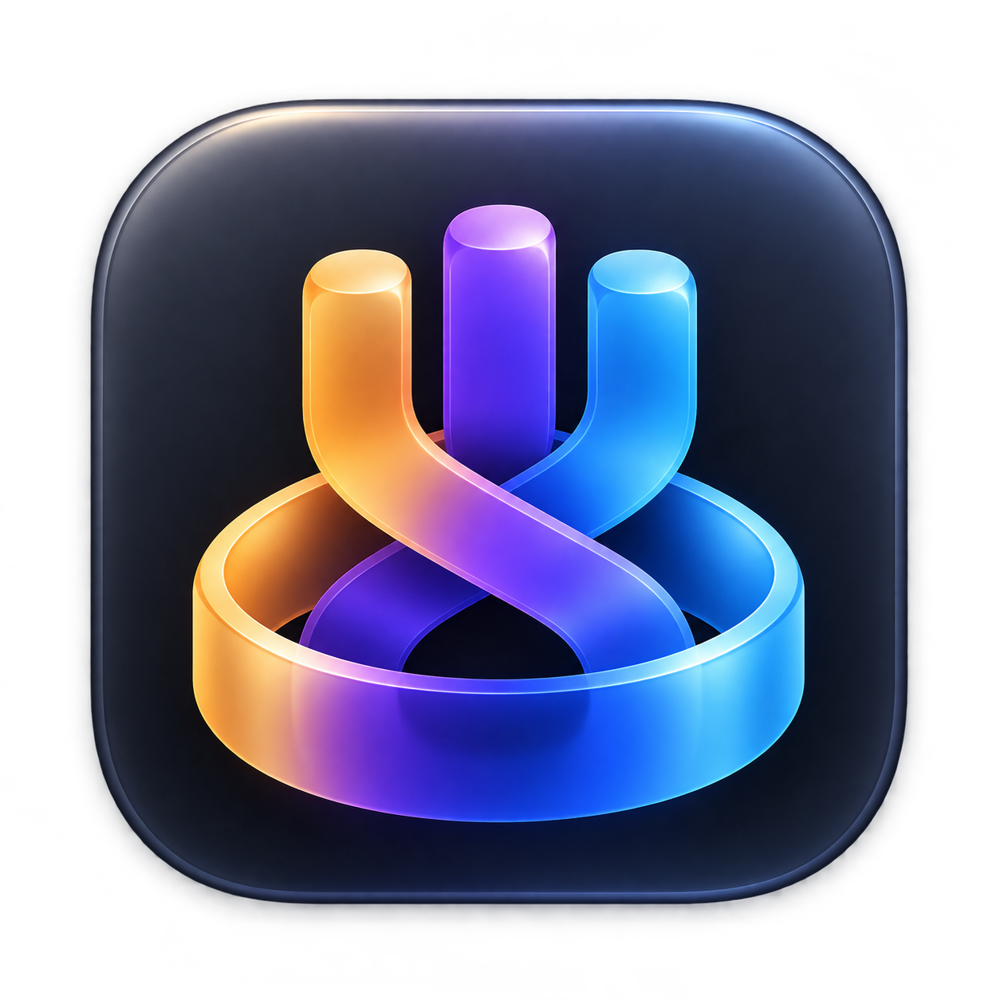
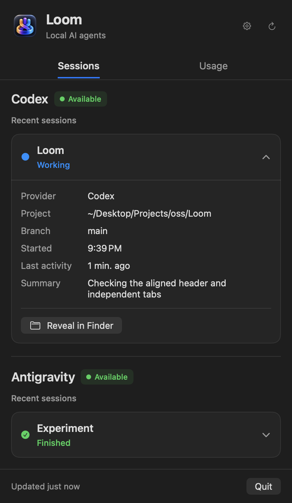
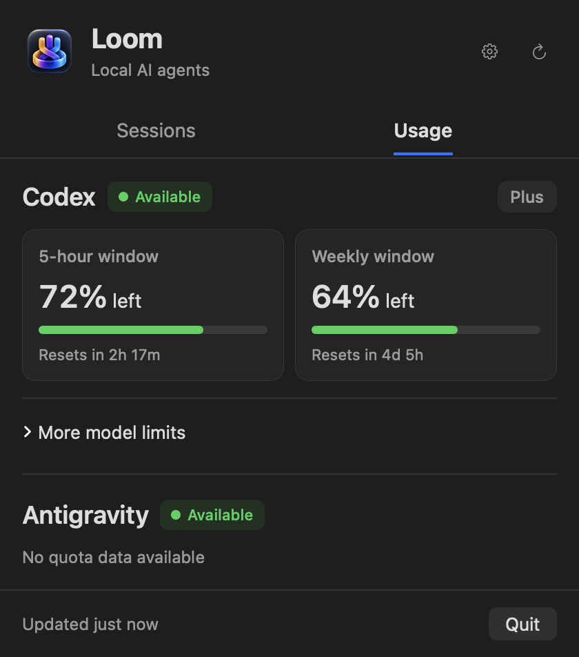

<p align="center"></p>
<h1 align="center">Loom</h1>
<p align="center"><strong>Three agents. One Loom.</strong><br>Local AI agents, one native macOS menu bar.</p>

Loom brings your local coding sessions and usage limits into one place. See which project an agent is working on, what needs attention, and how much quota remains—without switching between terminals and apps.

Built with Swift and SwiftUI. No Loom account, hosted backend, analytics SDK, or third-party package dependencies. **Early V0:** integrations depend on locally available data and may change as upstream tools evolve.

## One menu, two views

**Sessions** answers “what is happening?” Project cards show working, waiting, finished, failed, idle, or unknown states. Expand a session for available paths, branches, timestamps and summaries; reveal its project in Finder when a path exists.

**Usage** answers “how much room do I have?” See remaining quota, reset times and additional model limits. Cached data, unavailable providers and errors remain visible; missing information is never presented as a healthy quota.

<p align="center">
  
  
</p>
<p align="center"><em>Illustrative demo data; these previews do not show live accounts.</em></p>

The menu fits its content within the available screen height, with scrolling for longer lists. Each tab preserves its own scroll and disclosure state. Refresh manually or use the configured background interval (60 seconds by default).

## Integrations

| Provider | Session discovery | Usage | Status |
| --- | --- | --- | --- |
| OpenAI Codex | Running processes and Git metadata | Local app-server interface | Implemented |
| Google Antigravity | Local session metadata | Local language-server interface | Implemented |
| Anthropic Claude Code | Demo fixtures only | No live adapter | Planned |

Normal launch registers **Codex and Antigravity**. Available reports provider discovery availability; it does not guarantee an installed CLI, authentication, an active session, or a usable quota response. Session details vary with the data each provider exposes. Codex currently reports session state conservatively as **Unknown** because process discovery does not prove whether an agent is working or waiting; the working states in the previews are illustrative demo data.

Loom is independent and is not affiliated with or endorsed by these providers.

## Build and run

Requires **macOS 14+** and **Swift 5.9+ / Xcode 15+**. Install the coding tools you want to monitor separately. From the repository root:

```bash
bash scripts/build-app.sh
open .build/Loom.app
```

This builds a Release executable and packages a local development app with the Loom icon. It is not a signed or notarized distribution download.

For Xcode, open `Loom.xcodeproj`, select the **Loom** scheme and **My Mac**, then press **⌘R**. Launch the bundled app when checking icon identity and native UI behavior.

### Preview without live agents

Build the bundle first using the command above. Demo data is explicitly opt-in and visibly labeled:

```bash
open -n .build/Loom.app --args --demo-mock
open -n .build/Loom.app --args --demo-empty
open -n .build/Loom.app --args --demo-failure
```

The mock fixture includes all three provider identities and the normalized states. It does not imply a shipped Claude Code integration.

## Local-first, read-only

Loom inspects local processes and metadata and queries local status interfaces. It does not inject prompts, approve commands, edit projects, or modify agent sessions. There is no Loom cloud service or telemetry pipeline.

Codex usage is queried through a local subprocess over standard input/output. Antigravity usage uses HTTPS to a discovered loopback endpoint. Its transport accepts local TLS trust only for the discovered loopback host and port, rejects redirects, and uses an ephemeral token in memory. This is a narrow local connection exception, not normal certificate-chain validation. Loom does not persist provider tokens or credentials. Monitored tools retain their own accounts and network behavior.

Paths and session summaries can contain sensitive information. Review screenshots and diagnostics before sharing them. See [security guidance](SECURITY.md) and the [architecture](docs/ARCHITECTURE.md).

## Development and verification

```bash
swift build

# Portable suite used by CI: 126 tests currently pass locally.
swift test --disable-sandbox --skip 'testRealAntigravityDiscoverySmokeTest|testDefaultCodexAppServerTransportSigtermResistantCancellation'

# Native menu sizing and interaction probe.
bash scripts/verify-menu-sizing.sh
```

The macOS [CI workflow](.github/workflows/ci.yml) builds/packages the app and runs that portable suite. Remote CI has not yet been verified. The native probe checks content sizing, tab/disclosure behavior and constrained layouts; it does not replace checking the actual menu bar on a Mac.

`swift test` runs the full suite. Two known checks prevent claiming a full pass: `testRealAntigravityDiscoverySmokeTest` can fail with SQLite error 14 when its local database is unavailable, and `testDefaultCodexAppServerTransportSigtermResistantCancellation` has a known subprocess cancellation hang. They remain in the suite; CI excludes them explicitly. Some live usage checks additionally require `ENABLE_LIVE_SMOKE_TESTS=1`.

Xcode builds are also supported:

```bash
xcodebuild build -project Loom.xcodeproj -scheme Loom -destination 'platform=macOS'
```

See [CONTRIBUTING](CONTRIBUTING.md) for fixtures, review expectations and provider work.

## What comes next

Reliable local discovery comes first: improve state accuracy, cover upstream format changes, and add a real Claude Code adapter. Better diagnostics and accessibility are also priorities. Remote control, cloud sync and orchestration are outside the current scope.

The visual identity stays simple: three independent strands woven into one Loom. The full-color app icon and simplified monochrome menu bar glyph share that silhouette. See [icon design notes](docs/ICON_DESIGN.md) and [product direction](docs/PRODUCT.md).

## License and author

Created by **[Deepak Sharma](https://github.com/chaiwithcode)**.

Loom's code, documentation and included assets are licensed under the [MIT License](LICENSE). You can use, modify and distribute them under its terms. [Branding guidance](BRANDING.md) explains how to distinguish your fork from the official project without changing that license.
